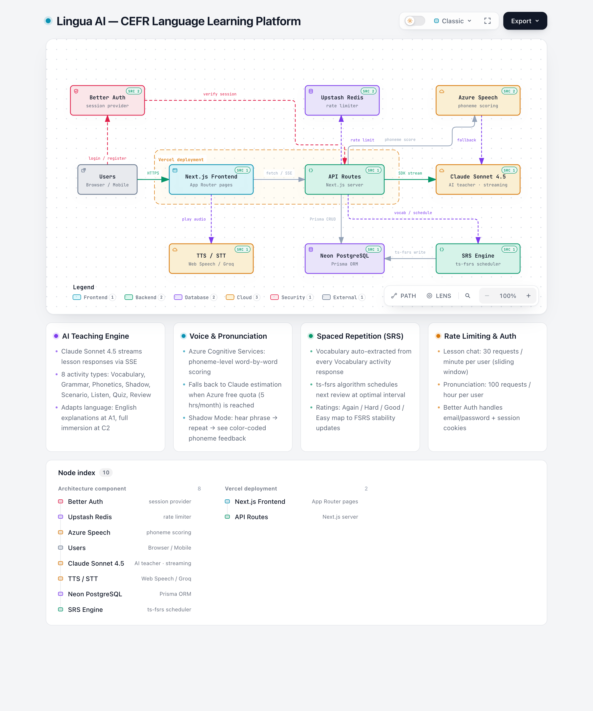

# Lingua AI — Learn French, German & Italian with an AI Teacher

> A voice-first language learning app that actually prepares you for real exams — not streaks and hearts.


---

## What is this?

Most language apps teach you to collect points. Lingua AI teaches you to speak.

It's a structured, CEFR-aligned curriculum (A1 → C2) for French, German, and Italian — built on the same framework used for official exams like **DELF**, **Goethe-Zertifikat**, and **CILS**. An AI teacher powered by Claude Sonnet guides every session: explaining grammar, drilling pronunciation, correcting mistakes in real time, and running realistic conversation simulations.

The goal isn't a 200-day streak. It's passing your exam.

---

## Features

### 🎓 Structured Curriculum

- 8 units per level × 6 CEFR levels × 3 languages = 144 structured unit blocks
- 80 hours of content per level, covering the exact topics that appear on official exams
- Every session has a clear objective: vocabulary, grammar, pronunciation, or conversation

### 🤖 AI Teacher

- Powered by **Claude Sonnet 4.5** — the best model for nuanced language instruction
- Adapts teaching style to your CEFR level: English explanations at A1, full immersion at C2
- Phonetic guides for every new word: `**bonjour** [bon-ZHOOR] — hello`
- Gentle error correction format: _"Almost! The correct form is X because..."_
- Streams responses in real time so you're never waiting

### 🎤 Shadow Mode

- Hear a native phrase → repeat it → get pronunciation scored
- Powered by **Azure Cognitive Services** (phoneme-level scoring)
- Falls back to Claude-based estimation when Azure limit is reached
- Color-coded word-by-word feedback

### 🎭 Scenario Room

- 6 survival conversation simulations: café, hotel, market, train station, doctor, restaurant
- AI plays the native speaker and the corrector simultaneously
- Tracks how many corrections you needed per session

### 🔁 Spaced Repetition

- Vocabulary is automatically saved from every lesson
- **ts-fsrs** algorithm schedules reviews at the optimal moment
- Flashcard review with Again / Hard / Good / Easy ratings
- Each word stores accuracy history across all sessions

### 📊 Progress Tracking

- CEFR level tracker (A1 → C2) with skill bars: reading, writing, speaking, listening
- Hours completed vs. target hours per level
- Study streak and session count

---

## Tech Stack

| Layer                 | Technology                          |
| --------------------- | ----------------------------------- |
| Framework             | Next.js 16 (App Router)             |
| Language              | TypeScript (strict mode)            |
| Styling               | Tailwind CSS + shadcn/ui            |
| Auth                  | Better Auth                         |
| Database              | Neon (PostgreSQL) + Prisma          |
| Cache / Rate Limiting | Upstash Redis                       |
| AI Teacher            | Anthropic Claude Sonnet 4.5         |
| TTS                   | Web Speech API → Google Cloud TTS   |
| STT                   | Web Speech API → Groq Whisper       |
| Pronunciation         | Azure Cognitive Services Speech SDK |
| Spaced Repetition     | ts-fsrs                             |
| Deploy                | Vercel                              |

---

## Getting Started

### 1. Clone and install

```bash
git clone https://github.com/dinakaran-kannadhasan/lingua-ai.git
cd lingua-ai
pnpm install
```

### 2. Set up environment variables

```bash
cp .env.local.example .env.local
```

Open `.env.local` and fill in the values. The only required ones to get started:

| Variable                   | Where to get it                                                |
| -------------------------- | -------------------------------------------------------------- |
| `ANTHROPIC_API_KEY`        | [console.anthropic.com](https://console.anthropic.com)         |
| `DATABASE_URL`             | [neon.tech](https://neon.tech) — free tier                     |
| `BETTER_AUTH_SECRET`       | Run `openssl rand -base64 32`                                  |
| `UPSTASH_REDIS_REST_URL`   | [console.upstash.com](https://console.upstash.com) — free tier |
| `UPSTASH_REDIS_REST_TOKEN` | Same Upstash dashboard                                         |

Everything else (Azure, Google TTS, Groq) is optional for local development — the app falls back gracefully.

### 3. Push the database schema

```bash
pnpm exec prisma db push
pnpm exec prisma generate
```

### 4. Run

```bash
pnpm dev
```

Open [http://localhost:3000](http://localhost:3000), create an account, pick your language and level, and start your first lesson.

---

## Project Structure

```
src/
├── app/
│   ├── (auth)/          # login, register, forgot-password
│   ├── (app)/           # dashboard, curriculum, lesson, shadow, scenario, progress, review
│   └── api/             # lesson/chat, pronunciation, scenario/chat, vocabulary, progress
├── components/
│   ├── lesson/          # TeacherChat, ActivityBar, VoicePanel, ShadowMode, ScenarioChat
│   ├── curriculum/      # CurriculumBrowser
│   └── progress/        # CefrTracker, SkillBars
├── hooks/               # useLessonSession, useShadowMode, useVoiceRecorder, useTextToSpeech
├── lib/
│   ├── ai/              # claude.ts (prompts), pronunciation.ts (Azure)
│   ├── db/              # Prisma client + all query functions
│   ├── redis/           # Upstash client + rate limiters
│   ├── srs/             # ts-fsrs scheduler + vocabulary parser
│   └── curriculum/      # Full CEFR curriculum data (A1–C2)
└── types/
```

---

## Running Tests

```bash
# Unit + integration tests
pnpm test

# Watch mode
pnpm test:ui

# Coverage report
pnpm test:coverage

# Type check + lint + tests
pnpm validate
```

Tests cover: AI prompt structure (with snapshot tests), spaced repetition algorithm, vocabulary parser, CEFR tracker component, shadow mode navigation, and scenario data integrity.

---

## Deployment

See [DEPLOY.md](./DEPLOY.md) for the full step-by-step Vercel deployment guide, including:

- Which environment variables to add and where to get them
- How to run the schema migration against production
- Post-deploy verification checklist

---

## Roadmap

- [x] AI teacher with streaming responses
- [x] Shadow mode with pronunciation scoring
- [x] Scenario room (6 conversation types)
- [x] Spaced repetition vocabulary review
- [x] CEFR progress tracking
- [ ] Google Cloud TTS (neural teacher voice)
- [ ] Groq Whisper (accurate speech-to-text)
- [ ] Stripe subscription (Free / Learner / Pro / Lifetime)
- [ ] Mock exams (DELF, Goethe, CILS format)
- [ ] More languages

---

## Architecture



> Interactive version: open [`architecture-lingua-ai-20261011-120000/lingua-ai.html`](./architecture-lingua-ai-20261011-120000/lingua-ai.html) locally for the full explorable diagram with dark/light themes and export options.

---

## Contributing

Pull requests are welcome. For major changes, open an issue first to discuss what you'd like to change.

If you add a language, add entries to `src/lib/curriculum/data.ts` (LANGUAGES, SHADOW_PHRASES) and follow the existing pattern.

---

## License

MIT — use it, fork it, build on it.

---

Built by [@dinakaran-kannadhasan](https://github.com/dinakaran-kannadhasan) · Powered by [Claude](https://anthropic.com) · Deployed on [Vercel](https://vercel.com)
